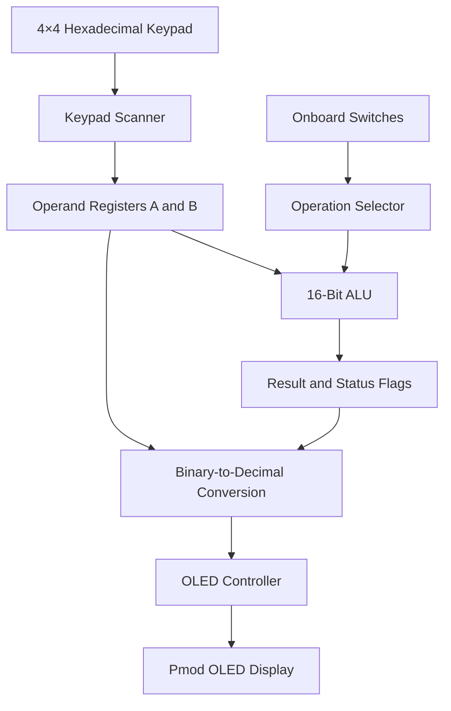

# 16-Bit ALU on Zybo Z7 FPGA

A 16-bit Arithmetic Logic Unit (ALU) implemented in Verilog HDL for the Zybo Z7 FPGA development board. The project integrates a hexadecimal keypad for operand entry, an ALU for arithmetic and logical operations, and an OLED display for real-time result presentation.

## Project Overview

This project demonstrates the design of a modular digital system using Verilog HDL and FPGA hardware. Users can enter two 16-bit operands through a 4×4 hexadecimal keypad, select an operation using onboard switches, and view the operands and computed result on an OLED display.

### Key Features

- 16-bit arithmetic and logical operations
- Signed and unsigned arithmetic
- Bitwise logic operations
- Logical shifts and circular rotations
- Four status flags: Zero, Carry, Overflow, and Negative
- 4×4 hexadecimal keypad input with debouncing
- OLED output with decimal and hexadecimal representations
- Operand selection, clearing, and backspace controls
- Modular RTL design using Verilog HDL

## System Architecture



## Hardware Requirements

- **FPGA board:** Digilent Zybo Z7
- **Input device:** Compatible 4×4 hexadecimal keypad, such as the Digilent Pmod KYPD
- **Display:** Compatible Digilent Pmod OLED with SSD1306 controller and 128×32 display
- **Development environment:** AMD Xilinx Vivado Design Suite
- **Description language:** Verilog HDL

The project uses the board clock, onboard switches, buttons, and LEDs, along with the JA, JC, and JE Pmod connections defined in `calc.xdc`.

Check the board variant and peripheral compatibility before programming the FPGA.

## Repository Structure

```text
16bit_Alu_ZyboZ7/
├── alu_16bit.v
├── keypad_scanner.v
├── oled_ctrl.v
├── calc_top.v
├── calc.xdc
└── README.md
```

| File | Description |
|---|---|
| `alu_16bit.v` | Combinational 16-bit ALU with arithmetic, logic, shift, and rotate operations |
| `keypad_scanner.v` | Scans the hexadecimal keypad and debounces key presses |
| `oled_ctrl.v` | Initializes and drives the OLED display |
| `calc_top.v` | Integrates the ALU, input controls, operand registers, conversion logic, and display |
| `calc.xdc` | Defines FPGA pin assignments, I/O standards, clock timing, and timing constraints |

## Supported ALU Operations

The ALU uses a 4-bit operation selector, `ALU_Sel`.

| Opcode | Operation | Description |
|---|---|---|
| `0000` | ADD | Unsigned addition |
| `0001` | SUB | Unsigned subtraction |
| `0010` | MUL | Unsigned multiplication |
| `0011` | DIV | Unsigned division |
| `0100` | AND | Bitwise AND |
| `0101` | OR | Bitwise OR |
| `0110` | XOR | Bitwise XOR |
| `0111` | NOT | Bitwise complement of operand A |
| `1000` | SADD | Signed addition |
| `1001` | SSUB | Signed subtraction |
| `1010` | SMUL | Signed multiplication |
| `1011` | SDIV | Signed division |
| `1100` | SHL | Logical shift left |
| `1101` | SHR | Logical shift right |
| `1110` | ROL | Rotate left |
| `1111` | ROR | Rotate right |

For shift and rotation operations, the shift amount is taken from the lower four bits of operand B, `B[3:0]`.

### Status Flags

The ALU generates four status flags:

- **Zero (Z):** Set when the 16-bit output is zero.
- **Carry (C):** Indicates carry-out in unsigned addition or borrow in unsigned subtraction; shift operations also use this flag.
- **Overflow (V):** Indicates overflow for supported signed arithmetic operations and specified exceptional cases.
- **Negative (N):** Represents the sign bit of the result for signed operations.

The ALU output is 16 bits wide. Multiplication results are truncated to the lower 16 bits, with overflow detection provided by the implementation.

## User Interface and Controls

### Operand Entry

The hexadecimal keypad accepts hexadecimal digits from `0` to `F`. Each accepted key is added to the currently selected operand by shifting the previous value four bits to the left.

Two operand registers are available:

- **Operand A:** First input to the ALU.
- **Operand B:** Second input to the ALU.

### Operation Selection

The four onboard switches, `sw[3:0]`, select one of the 16 ALU operations according to the opcode table.

### Control Inputs

| Control | Function |
|---|---|
| `ext_sw[1]` | Select operand A or B |
| `btn[0]` | Clear the selected operand |
| `btn[1]` | Clear both operands |
| `btn[2]` | Remove the last hexadecimal digit from the selected operand |
| `btn[3]` | System reset |
| `ext_sw[0]` | External reset |

### Display Output

The OLED controller displays the operands, ALU result, operation name, and numerical representations. Values are presented in decimal and hexadecimal formats, with signed display formatting for the signed arithmetic operations.

The onboard LEDs display the most recently accepted hexadecimal key.

## How to Run the Project

1. Install and open AMD Xilinx Vivado Design Suite.
2. Create a new RTL project targeting the correct Zybo Z7 FPGA variant.
3. Add the following Verilog source files:
   - `alu_16bit.v`
   - `keypad_scanner.v`
   - `oled_ctrl.v`
   - `calc_top.v`
4. Set `calc_top` as the top module.
5. Add `calc.xdc` as the constraints file.
6. Run **Elaborated Design** to inspect the RTL hierarchy.
7. Run **Synthesis** and review any warnings or errors.
8. Run **Implementation** and generate the bitstream.
9. Connect the compatible keypad and OLED peripherals to their specified Pmod connectors.
10. Program the FPGA and test the supported operations.

The exact FPGA part number must match your board. Review timing reports and verify the physical pin assignments before programming the hardware.

## Design Concepts Demonstrated

This project provides practical experience with:

- Combinational logic design
- Arithmetic and logic unit architecture
- Signed and unsigned number representation
- Overflow and status-flag generation
- Finite-state machines for keypad scanning
- Input synchronization and debouncing
- Binary-to-decimal conversion
- Serial peripheral display control
- Hierarchical RTL design and FPGA pin constraints


## Author

**Sai Srivanth K**

Electronics and Communication Engineering

GitHub: [@SaisrivanthK](https://github.com/SaisrivanthK)
LinkedIn: [@SaisrivanthK](www.linkedin.com/in/saisrivanth-k)

## License

No license has been specified yet. A license can be added if you want others to reuse, modify, or distribute this project under defined terms.
